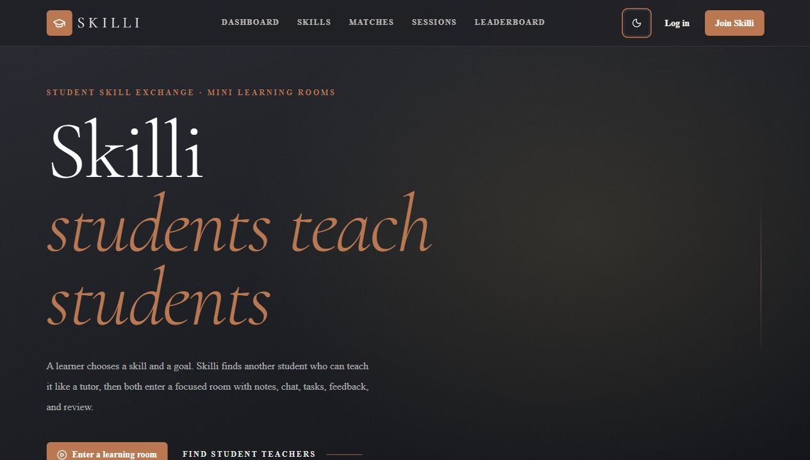
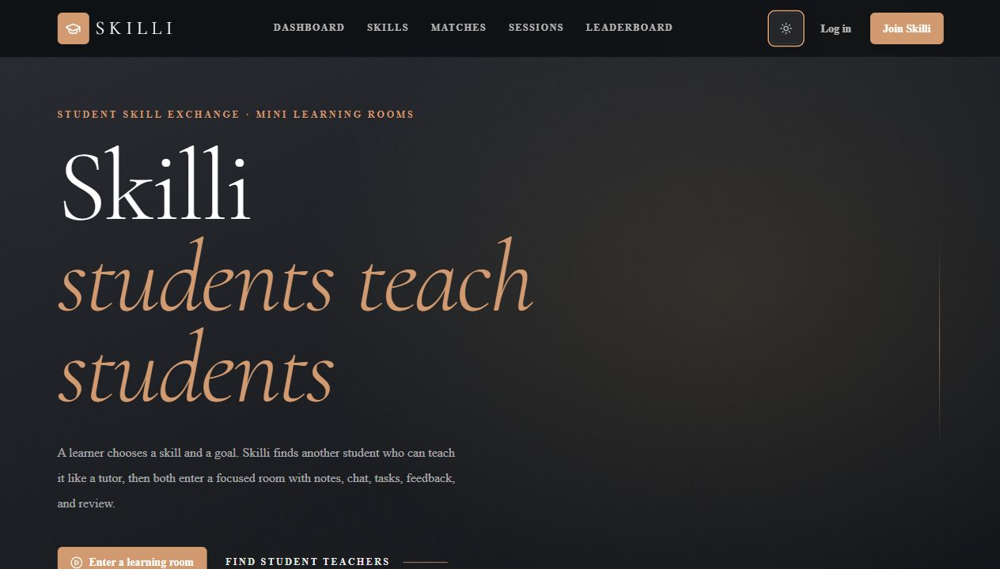
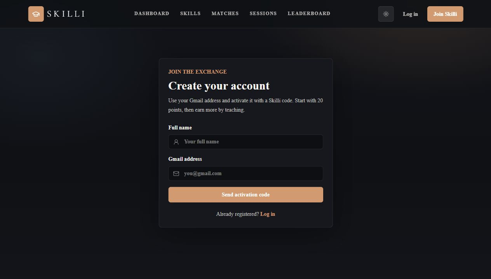

# Skilli — Student Skill Exchange Platform

## Overview

Skilli is a full-stack student skill-exchange platform where learners and student teachers can meet, book focused learning sessions, chat, share lesson notes, complete tasks, and build reputation through points and reviews.

The platform is designed around peer-to-peer learning instead of direct payment. Students can teach what they know, learn what they need, and grow through sessions, feedback, and XP.

## Live Demo

[https://skilli-two.vercel.app](https://skilli-two.vercel.app)

## Screenshots

| Landing page | Night mode |
| --- | --- |
|  |  |

| Gmail activation |
| --- |
|  |

## Features

- Passwordless Gmail activation using Supabase OTP codes
- Student profiles with skills to teach and skills to learn
- Skill discovery and match suggestions
- Session booking with goals, duration, mode, and optional meeting links
- Mini learning rooms with chat, lesson notes, tasks, submissions, and feedback
- Reviews, ratings, points, and XP
- Leaderboard for active contributors
- Light and night mode UI
- Responsive Next.js interface
- Supabase PostgreSQL schema with Row Level Security policies

## Tech Stack

- Next.js App Router
- React
- TypeScript
- Tailwind CSS
- Supabase Auth
- Supabase PostgreSQL
- Supabase Realtime
- Row Level Security
- Vercel

## Why I Built It

Many students need help with specific skills but do not always have access to paid courses, tutors, or structured communities. I built Skilli to make peer learning easier: students can exchange knowledge, book sessions, track progress, and build trust through reviews and points.

## What I Learned

- Building a complete full-stack app with Next.js and Supabase
- Designing authentication flows with email activation codes
- Modeling relational data for users, skills, sessions, tasks, reviews, and points
- Writing Supabase policies to protect user data
- Creating responsive dashboards and learning-room workflows
- Deploying a production Next.js app with environment variables on Vercel

## Installation

Clone the repository:

```bash
git clone https://github.com/amenallah5577/Skilli.git
cd Skilli
```

Install dependencies:

```bash
npm install
```

Create `.env.local` from `.env.example`:

```env
NEXT_PUBLIC_SUPABASE_URL=https://your-project-ref.supabase.co
NEXT_PUBLIC_SUPABASE_PUBLISHABLE_KEY=sb_publishable_your_key
NEXT_PUBLIC_SITE_URL=http://localhost:3000
```

Set up Supabase:

1. Create a Supabase project.
2. Run `supabase/migrations/20260508000000_init_skilli.sql` in the SQL editor.
3. Enable the Email provider in Authentication.
4. In Authentication > Email Templates, include `{{ .Token }}` so users receive a login code.
5. Add redirect URLs:

```text
http://localhost:3000/auth/callback
https://skilli-two.vercel.app/auth/callback
```

Start the development server:

```bash
npm run dev
```

Open `http://localhost:3000`.

Run quality checks:

```bash
npm run typecheck
npm run lint
npm run build
```

## Future Improvements

- Add smarter matching based on availability, level, and learning goals
- Add calendar integrations for booked sessions
- Add richer notification workflows
- Add analytics for learning progress and teaching activity
- Add more moderation tools for reviews, chat, and session content
